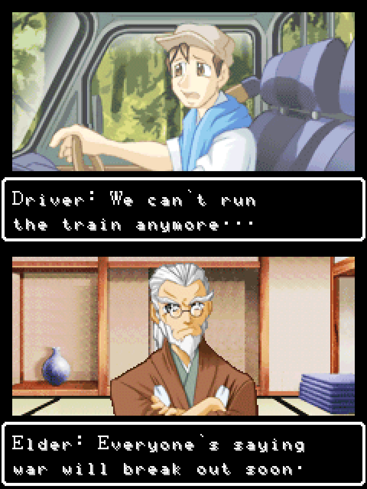

# Youkaidou — English translation

A work-in-progress English fan translation of **Youkaidou for Game Boy Advance**.
Current version: **v08**. Dialogue and menus use mixed-case English.

## Current progress

- The delivery rescue is won and the ride home, elder report and next quest
  are now verified in the game. All six menus in this batch were checked with
  both replies selected, including both village rest choices.
- **106 of 116 dialogue pages** in the 186-line batch pass exact screen checks,
  up from six checked pages in v07. Ten conditional or unvisited pages remain.
- New in v08: **HP Med** fits the inventory's original six-character space.
  Normal item use still restores HP. Two elder lines were also corrected.
- Saving and Continue preserve the next quest. A real v07 save also loads
  correctly. The complete evidence set covers **338 dialogue pages, 46 choice
  captures, seven level-up messages and five item checks**.
- This is a partial translation. Later chapters, post-warning house dialogue
  and some UI remain Japanese. Pending checks are listed in the reports.

## Screenshots from the working translation

Real emulator captures of the driver's train problem and the elder's warning,
enlarged without smoothing:



The translated medicine name in the working inventory:


## Try v08

[Download the v08 IPS patch](https://github.com/Dynamon91/Youkaidou-translated/raw/refs/heads/main/Youkaidou_English_v08.ips)
and apply it to the clean Japanese ROM with an IPS patcher.

Required original: `YOUKAIDOU`, game code `AFUJ`, 8,388,608 bytes.
SHA-256: `080a70324ee02c0ef850fccec0c2353faff4598e1f18cdf35277f5c05ba3ce06`.
Apply the patch to the clean original, not an earlier English build.

To build from source with Python 3.8 or newer:

```sh
python3 build_patch.py "/path/to/Youkaidou (Japan).gba" --output rebuilt
```

The repository contains translation files, the patch builder, IPS patches and
screenshot evidence. See [v08 technical notes](docs/technical-notes-v08.md)
for the detailed checks and remaining work.
