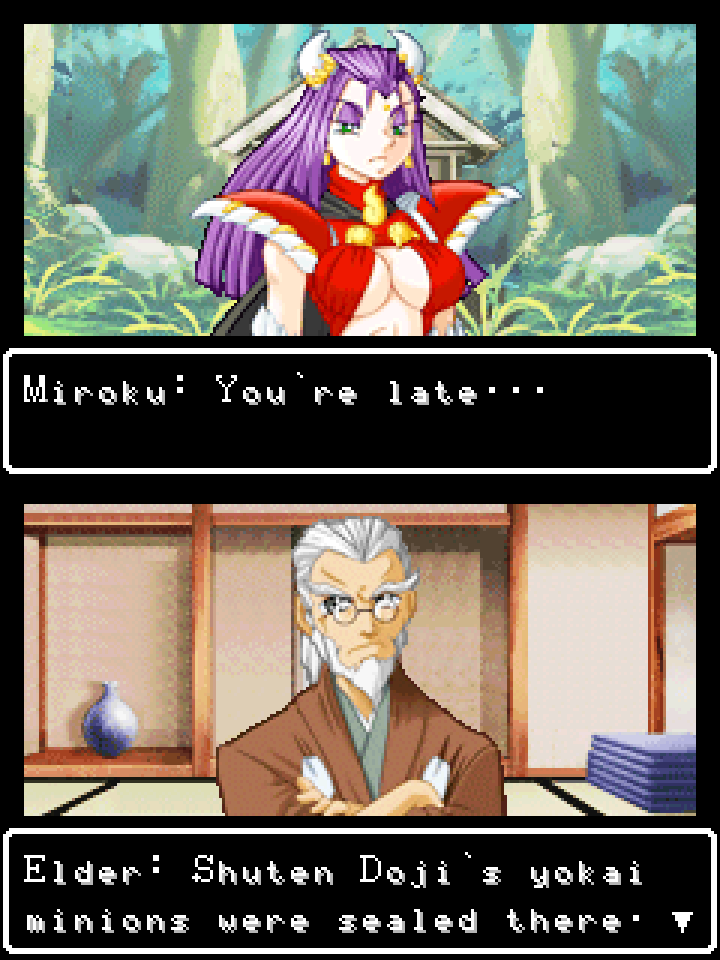
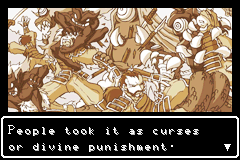
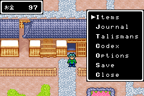

# Youkaidou — English translation

A work-in-progress English fan translation of **Youkaidou for Game Boy Advance**.
Current version: **v05**.

The project translates menus and early story dialogue into natural, mixed-case
English while keeping the original text boxes, choices, and character-name variables.

## Current progress

- English menus, the full 27-page opening, village and house conversations.
- New in v05: 125 English lines for the shrine incident, the elder's explanation,
  and related reminders.
- 188 dialogue pages, 22 choice captures, and seven level-up messages have passed
  text-pixel checks in mGBA. Saving, Continue, and an early v04 save were also checked.
- Later chapters and some UI text are still Japanese. Some translated branches
  still need to be reached and checked in game.

## Screenshots from the working translation

These are real emulator captures. The first image shows the new shrine dialogue
and the elder's explanation, enlarged without smoothing.



English opening narration:



English field menu after loading a save:



## Try v05

[Download the v05 IPS patch](https://github.com/Dynamon91/Youkaidou-translated/raw/refs/heads/main/Youkaidou_English_v05.ips)
and apply it to the clean Japanese ROM with an IPS patcher.

Required original: `YOUKAIDOU`, game code `AFUJ`, 8,388,608 bytes.
SHA-256: `080a70324ee02c0ef850fccec0c2353faff4598e1f18cdf35277f5c05ba3ce06`.
Apply the patch to the original Japanese game, not a previous English version.

To build from source with Python 3.8 or newer:

```sh
python3 build_patch.py "/path/to/Youkaidou (Japan).gba" --output rebuilt
```

The repository contains translation files, the patch builder, the IPS patch,
and screenshot evidence. See [technical notes](docs/technical-notes-v05.md)
for the detailed verification results and remaining work.

The translation is still in progress and is not affiliated with the original developers.
