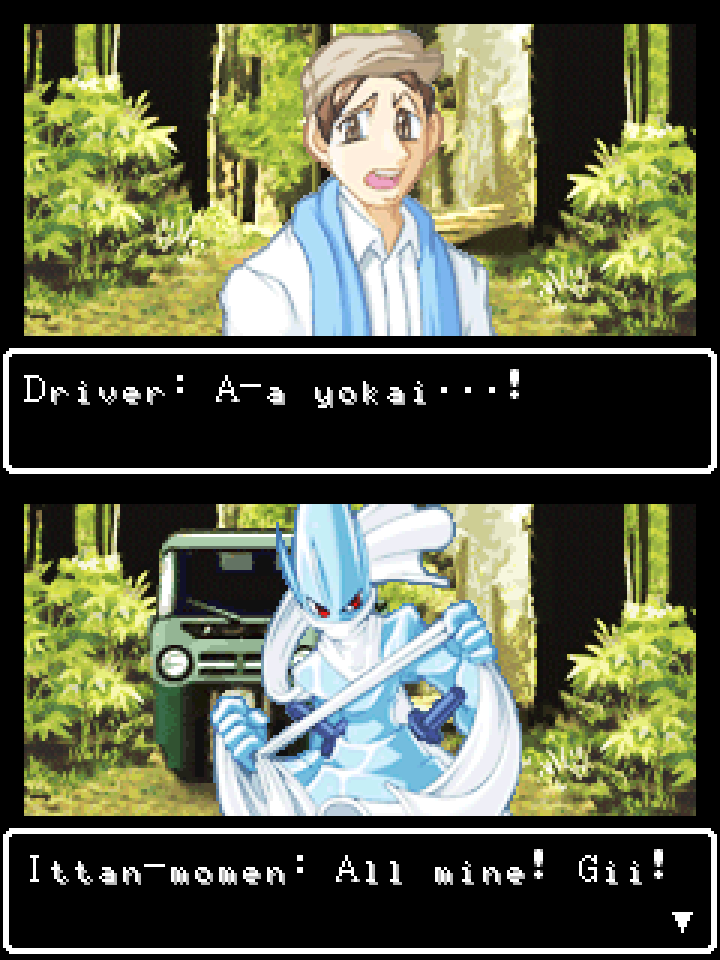
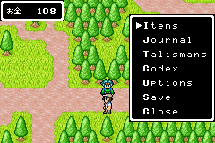

# Youkaidou — English translation

A work-in-progress English fan translation of **Youkaidou for Game Boy Advance**.
Current version: **v07**.

Menus and early story dialogue use natural, mixed-case English while preserving
the original text boxes, choices, and character-name variables.

## Current progress

- New in v07: **186 English lines** for the delivery rescue, the truck ride home,
  village conversations, the elder's war warning, and the next departure.
- Fixed a real text-buffer overflow in Ittan-momen's introduction. The driver
  and Ittan-momen introductions, the road sign and a Healing Med pickup now pass
  exact screen checks: **6 of 117 new dialogue pages**.
- The other **111 pages and all six new choice menus await playtests**. The
  rescue battle starts; victory and the subsequent story have not been verified.
- Saving and Continue work on the delivery road. A v06 save also loads in v07
  and preserves the accepted mission.
- Included evidence covers **238 dialogue pages, 34 choice captures and seven
  level-up messages**, with earlier captures rechecked against unchanged fonts.
- Later chapters and some UI remain Japanese. This is a partial translation.

## Screenshots from the working translation

Real emulator captures of the delivery driver and Ittan-momen, enlarged without
smoothing. These show the new dialogue running in the final v07 build.



English field menu after saving and Continue:



## Try v07

[Download the v07 IPS patch](https://github.com/Dynamon91/Youkaidou-translated/raw/refs/heads/main/Youkaidou_English_v07.ips)
and apply it to the clean Japanese ROM with an IPS patcher.

Required original: `YOUKAIDOU`, game code `AFUJ`, 8,388,608 bytes.
SHA-256: `080a70324ee02c0ef850fccec0c2353faff4598e1f18cdf35277f5c05ba3ce06`.
Apply the patch to the clean original, not an earlier English build.

To build from source with Python 3.8 or newer:

```sh
python3 build_patch.py "/path/to/Youkaidou (Japan).gba" --output rebuilt
```

The repository contains translation files, the patch builder, IPS patches, and
screenshot evidence. See [v07 technical notes](docs/technical-notes-v07.md)
for detailed checks and remaining work.
