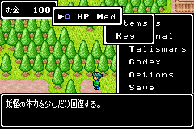

# Youkaidou — English translation

A work-in-progress English fan translation of **Youkaidou for Game Boy Advance**.

Current stable release: **v08**. A separate development branch, **v0.9-journey-houses**, contains the next incremental dialogue update.

## Current progress

- The delivery rescue is won and the ride home, elder report and next quest
  are now verified in the game. All six menus in this batch were checked with
  both replies selected, including both village rest choices.
- **106 of 116 dialogue pages** in the 186-line batch pass exact screen checks,
  up from six checked pages in v07. Ten conditional or unvisited pages remain.
- New in v08: **HP Med** fits the inventory's original six-character space.
  Normal item use still restores HP. Two elder lines were also corrected.
- Saving and Continue preserve the next quest. A real v07 save also loads
  correctly. The complete evidence set covers **338 dialogue pages, 46 choice
  captures, seven level-up messages and five item checks**.
- This is still a partial translation. Later chapters and some UI remain
  Japanese. Pending checks are listed in the reports.


## v0.9r1 development update — graphics preflight and text fidelity

The branch now includes a verified 34-byte [v0.9 → v0.9r1 hotfix](Youkaidou_v09_to_v09r1_text_hotfix.ips) for one Yayoi line, plus a new [v0.9r1 translation manifest](journey_houses_translations_v09r1.json), [direct-patch builder](build_journey_houses_v09r1.py), [static graphics integrity report](verification/v09r1/graphics_preflight.json) and [emulator screenshot acceptance checklist](docs/visual-review-v09r1.md).

The contextual correction restores Yayoi's question about joking: `Yayoi: Joking? Really okay?` (27 cells). The patch does **not** modify font bitmaps, background tiles, menu assets or the GBA ROM header; the 19 dialogue pages and three choice menus satisfy static cell-budget checks. **Real mGBA visual/gameplay verification is pending.**

**Patch order using the files hosted here:** clean AFUJ ROM → v08 IPS → v09 Journey & Houses IPS extracted from the [v09 package](Youkaidou_v09_Journey_Houses_Package.zip) → [v09r1 hotfix](Youkaidou_v09_to_v09r1_text_hotfix.ips). Alternatively, use the direct v09r1 patch generated by the new builder *instead of* v09 plus hotfix. Never stack the direct v09r1 patch on top of v09.

## v0.9 development update — journey and houses

The [v0.9 development branch](https://github.com/Dynamon91/Youkaidou-translated/tree/v0.9-journey-houses)
adds **26 translated text records across 19 dialogue pages and 3 choice menus**.
Player-name variables and original event control flow are preserved. Static
layout, LZSS and IPS round-trip checks pass. The add-on's ROM write ranges were
checked against the v08 patch; there are no overlapping records.

**Gameplay verification is pending.** This branch is not yet a replacement for
the v08 release and should not be merged into `main` until mGBA testing passes.

- [Download the complete v0.9 package ZIP](https://github.com/Dynamon91/Youkaidou-translated/raw/refs/heads/v0.9-journey-houses/Youkaidou_v09_Journey_Houses_Package.zip)
- [v0.9 translation manifest](journey_houses_translations.json)
- [v0.9 technical notes](docs/technical-notes-v09-journey-houses.md)
- [v0.9 static validation report](verification/v09/journey_houses_static_validation.json)

**Patch order:** apply the v08 IPS to the clean Japanese ROM first, then apply
the v0.9 journey-and-houses add-on.

## Screenshots from the working translation

Real emulator captures of the driver's train problem and the elder's warning,
enlarged without smoothing:


The translated medicine name in the working inventory:



## Try v08

[Download the v08 IPS patch](https://github.com/Dynamon91/Youkaidou-translated/raw/refs/heads/main/Youkaidou_English_v08.ips)
and apply it to the clean Japanese ROM with an IPS patcher.

Required original: `YOUKAIDOU`, game code `AFUJ`, 8,388,608 bytes.
SHA-256: `080a70324ee02c0ef850fccec0c2353faff4598e1f18cdf35277f5c05ba3ce06`.
Apply the patch to the clean original, not an earlier English build.

To build v08 from source with Python 3.8 or newer:

```sh
python3 build_patch.py "/path/to/Youkaidou (Japan).gba" --output rebuilt
```

For the v0.9 add-on build, see
[the v0.9 technical notes](docs/technical-notes-v09-journey-houses.md).

The repository contains translation files, patch builders, IPS patches and
screenshot evidence. See [v08 technical notes](docs/technical-notes-v08.md)
for the detailed checks and remaining work.
