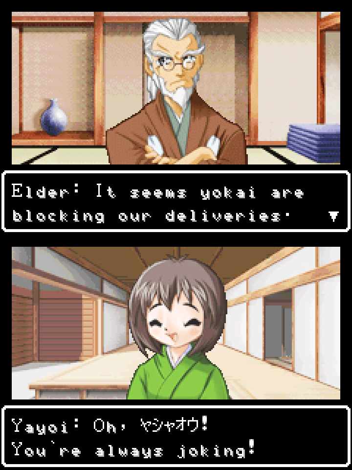
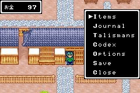

# Youkaidou — English translation

A work-in-progress English fan translation of **Youkaidou for Game Boy Advance**.
Current version: **v06**.

Menus and early story dialogue use natural, mixed-case English while preserving
the original text boxes, choices, and character-name variables.

## Current progress

- New in v06: **140 English lines** for the village's supply shortage, the elder's
  request, departure conversations, and party tips.
- The request's acceptance, refusal, and return-after-refusal paths were checked,
  along with both home/rest choices and the main replies to Yayoi.
- **44 of 83 new dialogue pages** passed exact text-pixel checks. Across the
  project, the included evidence covers **232 dialogue pages, 34 choice captures,
  and seven level-up messages**.
- Saving and Continue preserve the accepted mission. An earlier v05 save also
  loads correctly in v06.
- Later chapters and some UI text are still Japanese. Untested translated
  branches are identified in the verification reports.

## Screenshots from the working translation

Real emulator captures of the supply-shortage story and Yayoi's reply, enlarged
without smoothing. The player name remains the game's variable.



English field menu after loading the accepted mission:



## Try v06

[Download the v06 IPS patch](https://github.com/Dynamon91/Youkaidou-translated/raw/refs/heads/main/Youkaidou_English_v06.ips)
and apply it to the clean Japanese ROM with an IPS patcher.

Required original: `YOUKAIDOU`, game code `AFUJ`, 8,388,608 bytes.
SHA-256: `080a70324ee02c0ef850fccec0c2353faff4598e1f18cdf35277f5c05ba3ce06`.
Apply the patch to the clean original, not an earlier English build.

To build from source with Python 3.8 or newer:

```sh
python3 build_patch.py "/path/to/Youkaidou (Japan).gba" --output rebuilt
```

The repository contains the translation files, patch builder, IPS patches, and
screenshot evidence. See [v06 technical notes](docs/technical-notes-v06.md)
for detailed results and remaining work.
