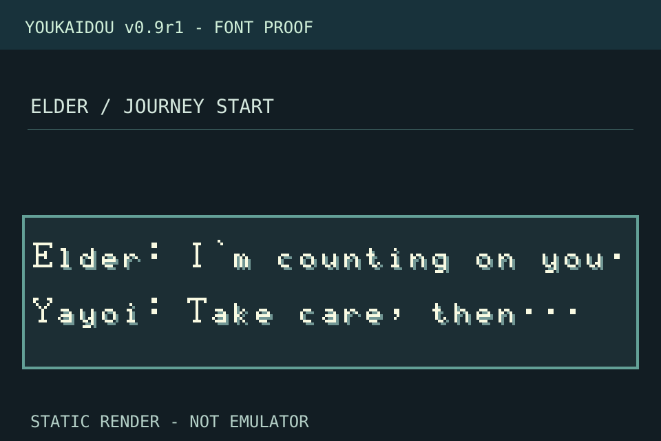
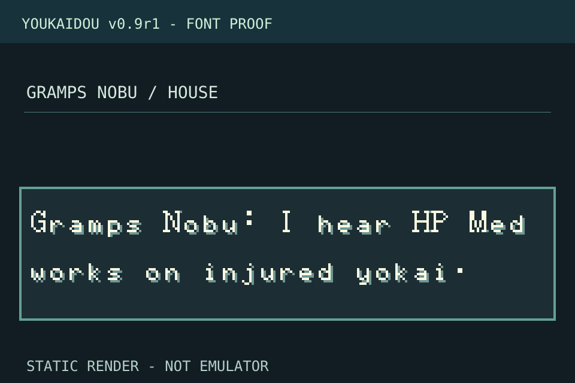
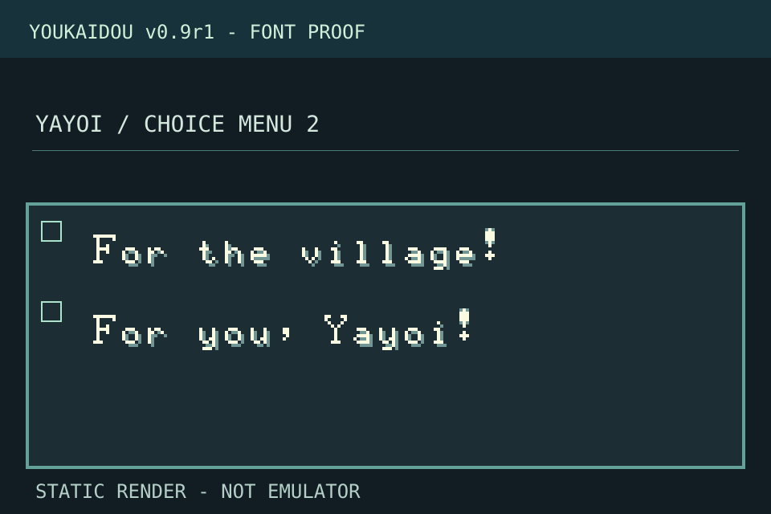
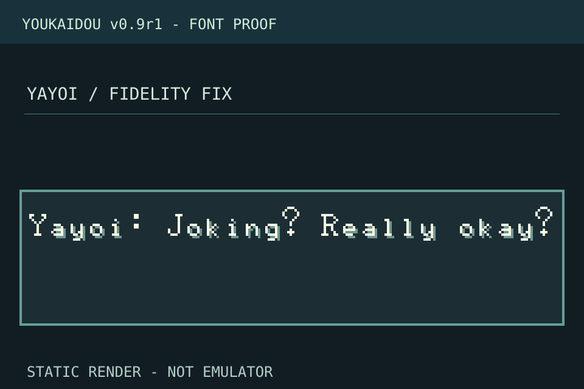

# v0.9r1 — ROM-font pixel checks and new previews

Static font verification now covers **47 distinct characters (46 inked glyphs plus the space character)** used by the journey-and-houses localized event; **zero missing font glyphs** were found. All 26 string records were separately confirmed present in the decoded v0.9r1 patched event during the local QA run, and five negative controls were correctly rejected.

The four new images below are **static previews reconstructed using the v0.8 patched 8x16 GBA glyph bitmaps and v0.9r1 script strings**. The background and preview frame are diagnostic placeholders, not actual game graphics or actual emulator screenshots. This distinction is deliberate.

Local verification script: `python3 qa/rom_font_pixel_check.py "/path/to/Youkaidou (Japan).gba"`. A legitimate unmodified AFUJ source ROM is required. The repository contains no commercial ROM.

**Unverified:** mGBA gameplay, dialogue box rendering in the actual engine, sprite placement, menu navigation, scene transitions, and save/load. Preserve the stable v0.8 branch until these checks pass.
